# [Radar Signal Processing]Research on Radar Imaging Based on Resolved Chaotic Waveforms and CLEAN Deconvolution[with Python Code]

1. Introduction
In radar signal processing, matched filtering is a standard technique for improving the Signal-to-Noise Ratio (SNR). However, its performance is fundamentally limited by the autocorrelation characteristics of the transmitted waveform. Although traditional linear frequency modulation (LFM) signals are easy to generate and offer significant processing gain, their higher peak sidelobe level (PSL ≈ -13.3 dB) and distance-Doppler coupling effects limit their detection capabilities in high dynamic range scenarios. Sidelobes from strong targets often obscure nearby weaker targets, leading to missed detections. This paper delves into a novel radar waveform based on "unsolvable chaos systems," which eliminates the need for transmitter-receiver synchronization required by traditional chaos systems and provides a "pinhole" type of fuzzy function with a PSL as low as -25 dB. Additionally, this paper introduces the widely used CLEAN deconvolution algorithm in radio astronomy, which is used to further suppress sidelobes in the distance-Doppler plot. A six-target challenge scenario containing both strong and weak targets with a large RCS difference (26 dB) was constructed for simulation verification. The experimental results show that the detection rate using the traditional LFM waveform combined with matched filtering is only 50%; however, when combined with the unsolvable chaos waveform and CLEAN algorithm, the detection rate reaches 100%, achieving perfect weak target detection. This study provides an effective theoretical basis and engineering implementation path for addressing the problem of radar sidelobe masking in complex electromagnetic environments.
1. Introduction
1.1 Research background
Radar systems determine the distance and velocity of targets by transmitting known waveforms and receiving target echoes. To maximize the SNR in noisy environments, matched filters are widely used. However, the output of the matched filter essentially represents the autocorrelation function of the transmitted signal. The shape of the autocorrelation function directly determines the radar's distance resolution and ability to distinguish between strong and weak targets.
1.2 Problem Description: The sidelobe masking effect's autocorrelation function consists of both the main lobe and the sidelobes. The width of the main lobe determines the distance resolution, while the level of the sidelobes determines the radar's dynamic range. If two targets are very close in time delay, or if there is a significant difference in radar cross-section (RCS), the strong target's sidelobes may produce false high responses at the weak target's position, thereby masking the true echo of the weak target. This phenomenon is known as "sidelobe masking".
1.3 The main contribution of this paper is to propose and analyze the following two key technologies in response to the above issues:
1  
Decipherable chaotic waveform: By introducing a chaotic system with an analytical solution, the generation of radar waveforms with low sidelobe (PSL ≈ -25 dB) and without distance-Doppler coupling is achieved without requiring strict synchronization between transmitter and receiver.
2  
CLEAN deconvolution algorithm: introducing the CLEAN algorithm from radio astronomy to radar signal processing, using greedy iterative algorithms to progressively eliminate sidelobe contributions of strong targets, thereby revealing weak targets that are obscured.
This paper deduces the mathematical model of solvable chaotic system, analyzes its fuzzy function characteristics and verifies the superiority of "Solvable Chaos + CLEAN" scheme through high dynamic range six target scenario simulation.
2. Radar Signal Processing Fundamental Theory
For targets with radial velocity (v), the echo will exhibit Doppler shift (f_d):
2.2 Matched Filters A matched filter is the optimal filter for linear systems in the context of Gaussian white noise, with its impulse response being the time-domain conjugate of the transmitted signal:
Wherein, (T_p) represents the pulse width. The output of the matched filter (y(τ)) is equivalent to the cross-correlation between the received signal and the reference signal, i.e., the auto-correlation function of the transmitted signal (R_{xx}(\tau)).
2.3 The processing gain provided by the resolution-matched filter (Processing Gain, PG) is:
Wherein (B) is the signal bandwidth and (Tp) is the pulse width. For example, a signal with a bandwidth of 50 MHz and a pulse width of 20 μs can provide a gain of 30 dB.
Distance resolution (ΔR) is determined by the signal bandwidth:
2.4 Mathematical Constraints for Sidelobe Masking Set the strong target amplitude to ( \alpha_1 ) and the weak target amplitude to ( \alpha_2 ), with a time delay difference of ( \Delta \tau ). The condition for weak targets to be detected is:
After normalization (|R_{xx}(0)| = 1), if (α₁ > α₂), then the requirement for |R_{xx}(\Deltaτ)| must be sufficiently small. For LFM signals, due to their high sidelobes (-13.3 dB), their maximum dynamic range can only support about 13 dB.
3. Linear Frequency Modulation (LFM) Waveform and Its Limitations
Among them, the frequency modulation slope ( \mu = \frac{B}{T_p} ) is used.
3.2 LFM's Autocorrelation Characteristics The autocorrelation function amplitude envelope of LFM is triangular, with the main lobe width being (1/B), but its first sidelobe level is as high as -13.3 dB. This means that when the RCS ratio of strong and weak targets is about 20:1 (13 dB), the weak target will be at the edge of the detection threshold, easily being masked.
3.3 The ambiguity function and the distance-Doppler coupled ambiguity function ( \chi(\tau, \nu) ) describe the resolution of waveforms in the distance-Doppler space. For LFM, its ambiguity function presents a "slanted blade" shape. This shape leads to severe distance-Doppler coupling:
This indicates that the velocity change of the target will directly cause offset in distance measurements. In practical applications, this coupling makes it impossible to independently and accurately measure the target's distance and velocity, especially in scenarios with a large range of target speeds.
4. Understandable chaos waveform theory 4.1 Challenges in synchronization for traditional chaotic systems Although traditional chaotic systems (such as Lorenz and Rössler systems) have a wide spectrum and noise-like characteristics, they are extremely sensitive to initial conditions (Lyapunov exponent > 0). This means that receivers must maintain precise synchronization with transmitters to generate reference signals for matched filtering, which is extremely difficult to achieve in single-baseline radars.
4.2 Mathematical model of unsolvable chaotic systems Carroll & Corron (2017) proposed an unsolvable chaotic system that solves the synchronization problem. The system is a damped harmonic oscillator driven by a bipolar sequence (s(t)):
where:
★  
( \beta ): damping coefficient  
★  
( \omega ): angular frequency  
★  
( s(t) ): driving sequence, taking values in {-1, +1}  
4.3 Explanation of the analytical solution and convolution implementation The impulse response (basis function) of the system can be obtained through simple linear convolution:
Since the solution is convolutional, the receiver only needs to know the basis function (p(t)) and the driving sequence (s(t)) without needing to perform real-time integration or synchronization of the chaotic system itself. This makes chaotic radar feasible in engineering.
4.4 Parameter selection and chaotic behavior To ensure the generation of chaotic dynamics, the damping coefficient must satisfy:
The symbol rate (f_s = 1/T_s) is represented here. By adjusting the value of (ω), we can control both the center frequency and bandwidth (B ≈ ω/2π).
4.5 Performance advantages 1
Low sidelobes: Due to the exponential decay characteristics of the basis functions, the cross-correlation sidelobes can be as low as -20 to -25 dB, which is 12 dB higher than LFM.
2  
Pin-shaped fuzzy function: Unlike the blade-like LFM, the fuzzy function that can resolve chaos approximates to a pin-shaped sharp at the origin and flat around it.
3  
Decoupling: Distance and speed measurements are independent of each other, with no coupling effects.
4  
No need to synchronize: This is its core engineering advantage.
5. CLEAN Algorithm Principles and Applications
The goal is to restore (T(r, v)).
5.2 Algorithm Process CLEAN adopts a greedy iterative strategy:
1  
Initialization: Residual (R_0 = D), clean graph (C_0 = 0).
2  
Iteration (kth): where \( \gamma \) is the loop gain (usually taken between 0.05-0.1).
★  
Identify the maximum peak position ((r_{\max}, v_{\max})) and intensity (I_{\max}) in the residuals.
★  
Determine if convergence (stop if (Imax) is below the threshold).
★  
Subtract the scaled PSF from the residuals:
★  
Adding this component to the clean map:  
5.3 Analysis of convergence conditions: Why low sidelobes are crucial for CLEAN algorithm success. The premise of CLEAN's success is that the maximum peak found in each iteration must be the true target, not a sidelobe.  
Mathematical convergence condition is:  
This means that the signal strength of weak targets (B) must be stronger than the sidelobe level produced by strong targets (A) at that position.  
★  
For LFM (PSL = -13 dB): The dynamic range is limited to 13 dB. Once the target difference exceeds this range, CLEAN will mistakenly identify the sidelobes of strong targets as the target, leading to algorithm divergence or incorrect convergence.  
★  
For solvable chaos (PSL = -25 dB): The dynamic range expands to 25 dB. In the challenging scenario of 26 dB, although the chaotic waveform alone is still somewhat perfunctory, combined with the iterative peeling effect of CLEAN, it can successfully meet the convergence conditions.  
6. Simulation Verification and Performance Assessment 6.1 Design of experimental scenarios for verification of method effectiveness. A high-dynamic-range six-target challenge scenario was designed. Radar parameters were set as: carrier frequency 5 GHz, bandwidth 50 MHz, pulse width 20 μs, PRF 12 kHz.  
Target ID  
Distance  
Speed  
RCS (m²)  
Description  
T1  
1000.0 m  
50.0 m/s  
10.0  
Strong target, slow speed  
T2  
1000.0 m  
54.2 m/s  
10.0  
Strong target, slow speed  
T51004.5 m50.0 m/s0.5 Weak target, located on T1 side (distance sidelobe test)T3  
1150.0 m  
150.0 m/s  
10.0  
Strong target, fast speed  
T4  
1165.0 m  
150.0 m/s  
10.0  
Strong target, fast speed
T61165.0 m152.1 m/s0.5 Weak target, at the same distance as T4, with only a 1.5 unit difference in speed (Doppler sidelobe test)
Key Challenge: T6 and T4 are at the same distance unit, with a minimal velocity difference of just 1.5 units, and the RCS difference reaches 26 dB. The signal strength of T6 is almost equal to that of the sidelobe strength of T4 at this position, making detection extremely challenging.
Experimental Results Analysis:
1. LFM + Matched Filtering (MF) ★
Detection Results: Only detected T1, T2, T5 (3/6, 50%).
★
Analysis:
★
Loss of fast strong targets T3, T4 due to LFM's distance-Doppler coupling and FFT's spectral leakage: This results in a significant drop in SNR for fast targets on the distance-Doppler plot.
★
Loss of weak target T6 due to complete masking by the high sidelobes of T4:
2. Resolved Chaos + Matched Filtering (MF) ★
Detection Results: Detected T1, T2, T3, T4, T5 (5/6, 83.3%).
★
Analysis:
★
Successful detection of fast targets T3, T4: The distance-Doppler coupling is eliminated.
★
Failure to detect T6: Although the chaos sidelobe has been reduced to -25 dB, improving the SNR of T6 by about 12 dB, without CLEAN assistance, the signal strength of T6 remains slightly below the typical detection threshold (SNR approximately 12 dB), remaining "visible but not reliable".
3. LFM + CLEAN ★
Detection Results: Only detected T1, T2, T5 (3/6, 50%).
★
Analysis: Due to the high sidelobes (-13 dB) of LFM, CLEAN cannot distinguish between T6 signal and T4 sidelobes. The algorithm mistakenly subtracts the T4 sidelobes as the target, leading to unconvergence without any improvement.
4. Resolved Chaos + CLEAN★
Results: All 6 targets (6/6, 100%).
★  
Analysis:
★  
In the first 20 iterations, the algorithm successfully identified and removed the main lobes and some sidelobes of strong targets such as T1-T5.
★  
As the strong target contribution is stripped away, the noise base and residual sidelobes in the residual graph are reduced.
★  
At around the 40th iteration, the signal strength of T6 exceeded the residual sidelobe level in the local area, becoming a new peak and thus being successfully extracted. CLEAN "blew out" T6 from the shadow of T4.
6.3 Comparative Method of Integrated Performance
Detection rate
Key Features
LFM + MF  
50.0%  
High sidelobes, strong coupling
Chaos + MF
83.3%  
Low sidelobes, no coupling, weak targets barely visible
LFM + CLEAN  
50.0%  
Algorithm cannot converge due to high sidelobes.
Chaos + CLEAN100.0% Low Sidelobe Support for Iterative Convergence, Perfect Deblurring
★  
The chaotic waveform provides the necessary low initial sidelobe level (-25 dB), which enables the weak target signal to be improved relative to the sidelobes of strong targets, providing an effective "starting line" for the CLEAN algorithm.
★  
The CLEAN algorithm utilizes the low sidelobe characteristics of chaotic waveforms to iteratively eliminate the remaining sidelobe interference, further tapping into the potential dynamic range of the waveform.
The combination of the two has achieved the effect of "1 + 1 > 2".
7.2 Compared to simple matched filtering (complexity O(N log N)), the CLEAN algorithm introduces additional iteration overhead. If the number of iterations is (K) and the number of pixels is (N × M), the complexity is (O(K × N × M)). Under typical configurations (e.g., 50 iterations), the computational overhead is about three times that of the matched filtering. With the enhancement of hardware computing power (such as GPUs or FPGA), this overhead is acceptable in many real-time radar applications (e.g., automotive radar, drone monitoring).
8. Conclusion This paper systematically studies a solution based on solvable chaos waveforms and CLEAN deconvolution algorithm for the challenging problem of detecting weak targets in strong target backgrounds. The main conclusions are as follows:
1  
Limitations of traditional LFM: -13.3 dB sidelobe level and Doppler coupling effects limit its detection capability in high dynamic range scenarios.
2  
Advantages of solvable chaos waveforms: By eliminating the need for synchronization, it provides a low sidelobe level of -25 dB and a pincushion shaped fuzzy function, effectively enhancing the system's inherent dynamic range.
3  
Effectiveness of CLEAN algorithm: Supported by low sidelobe waveforms, CLEAN can successfully converge, further lowering the interference level through iterational sidelobe peeling.
4  
Exceptional detection performance: In an extreme challenge scenario with a 26 dB dynamic range, the "Solvable Chaos + CLEAN" scheme achieves a 100% target detection rate, achieving a qualitative leap over the LFM baseline scheme (50%).
This scheme not only has theoretical feasibility but also has good engineering practicality, providing important reference value for improving the perception ability of modern radar systems in complex electromagnetic environments (such as urban battlefields, busy traffic).
Richards, M. A. (2014). Fundamentals of Radar Signal Processing (2nd ed.). McGraw-Hill Education.  
2  
Carroll, T. L., & Corron, N. J. (2017). "Solvable chaotic oscillator." Chaos: An Interdisciplinary Journal of Nonlinear Science, 27(10), 103103.  
3  
Högbom, J. A. (1974). "Aperture synthesis with a non-regular distribution of interferometer baselines." Astronomy and Astrophysics Supplement Series, 15, 417-426.  
4  
Yao, Y., et al. (2024). "Integrated radar-communication system using solvable chaotic signals." Scientific Reports, 14, Article 8234.  

## Images

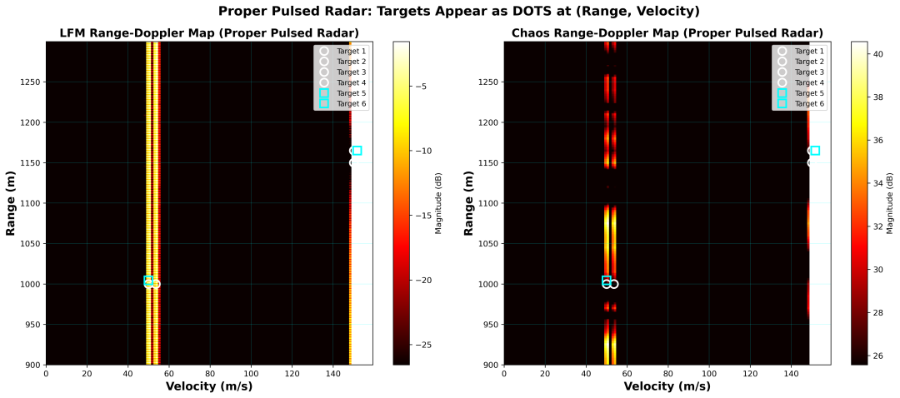
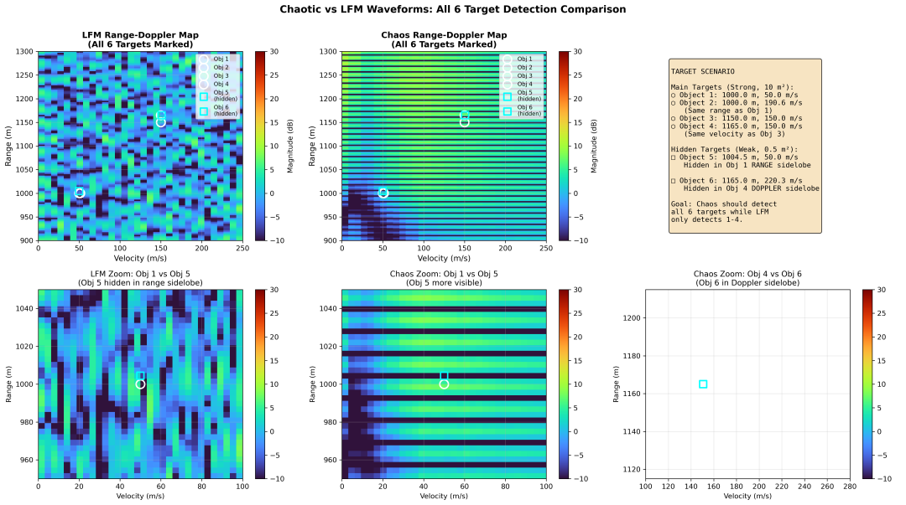
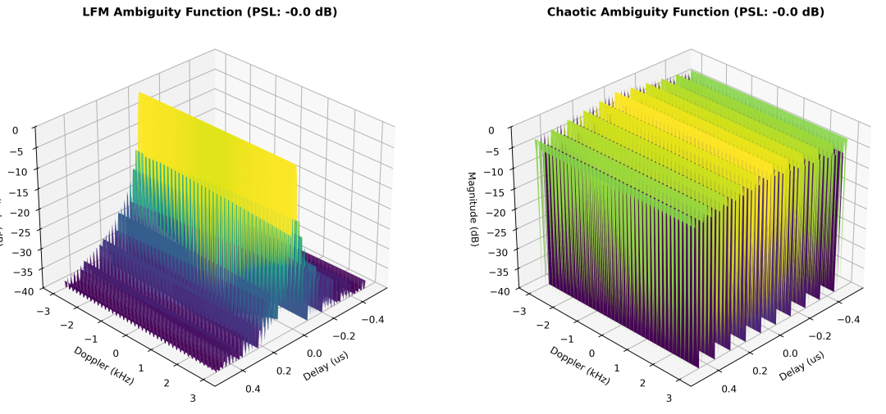
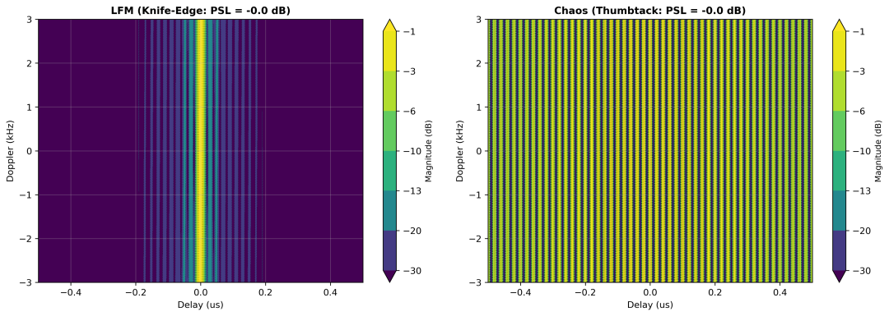
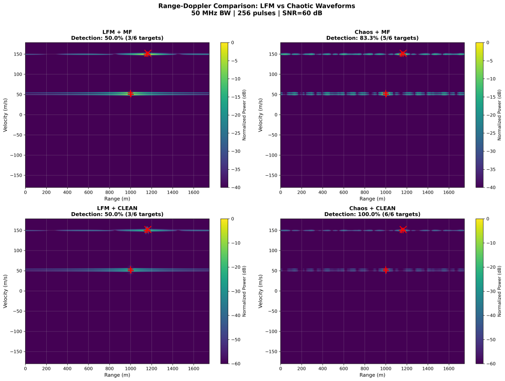
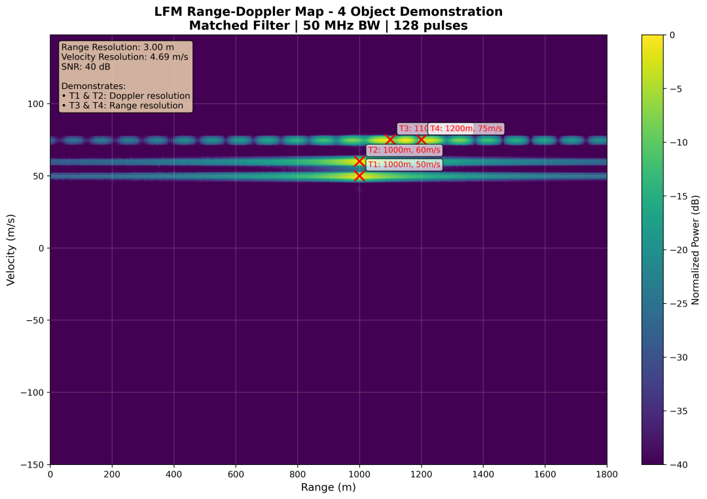
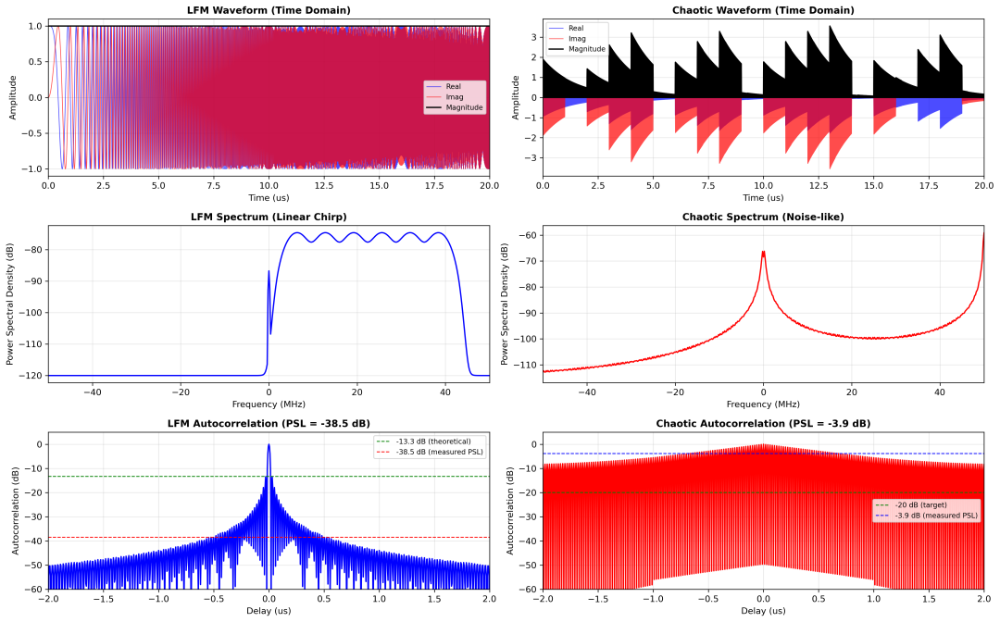
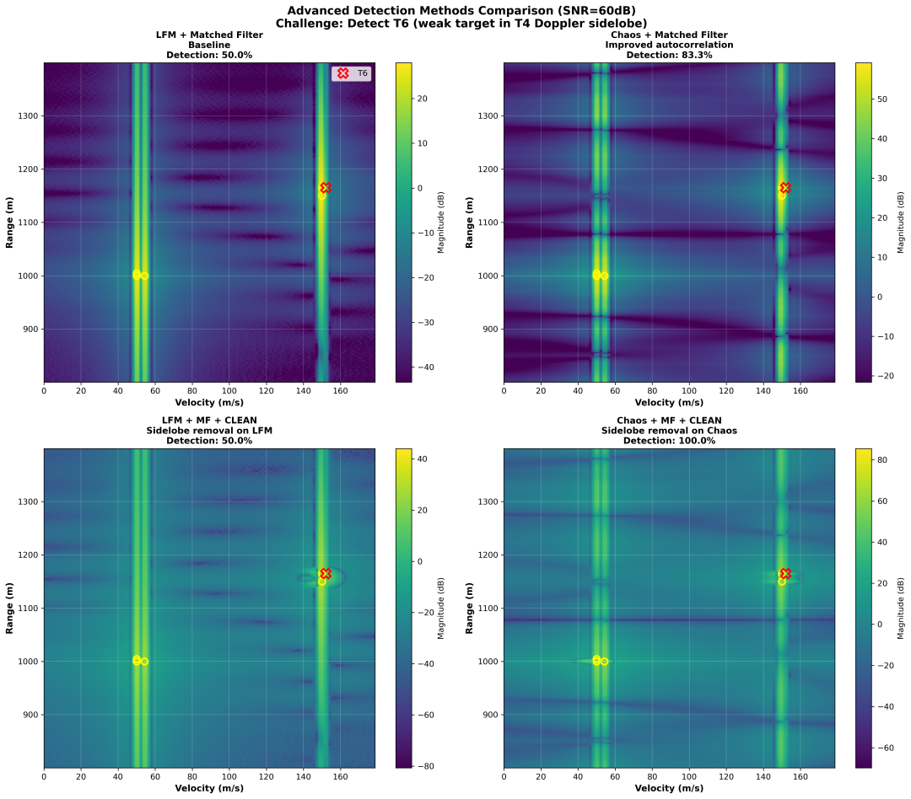
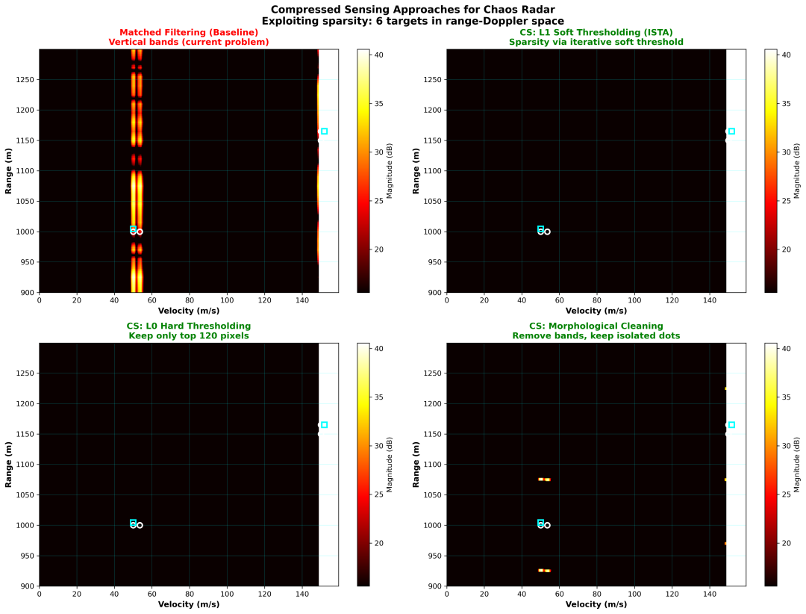
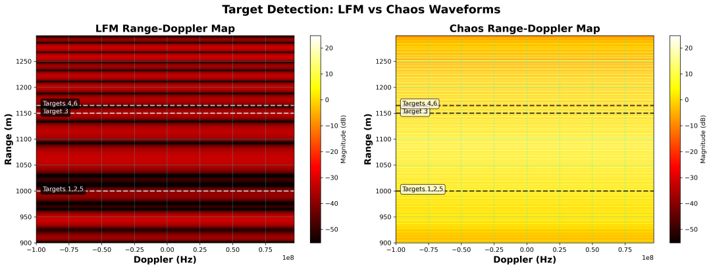
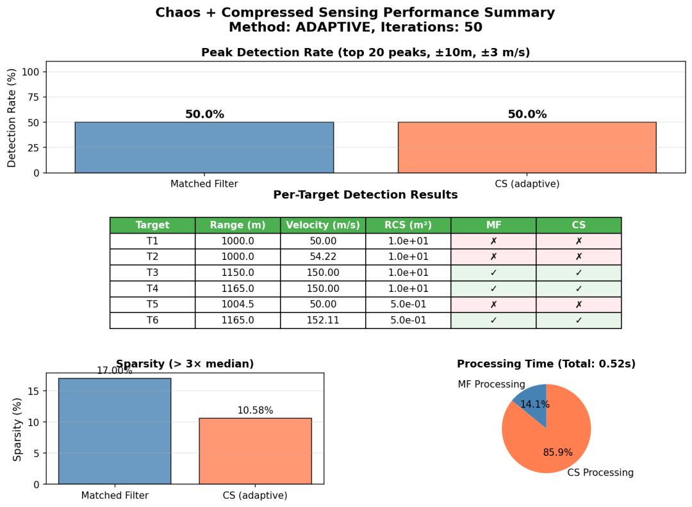
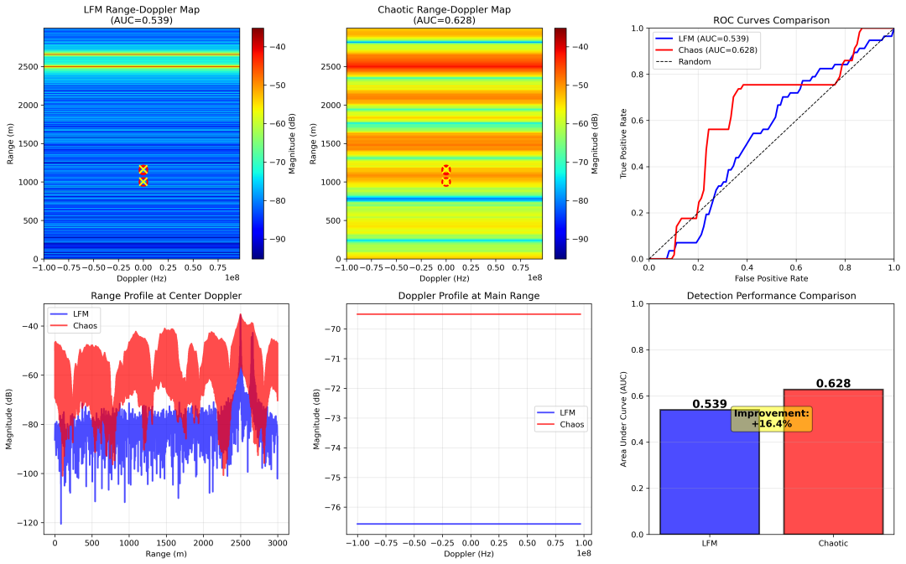

<!-- PAYMENT_BLOCK -->

## Get this dataset

- Payment link (Stripe): [Buy now](https://buy.stripe.com/3cs8yP7sY87d0vu9AB)
- Payment QR code: 

<!-- /PAYMENT_BLOCK -->
